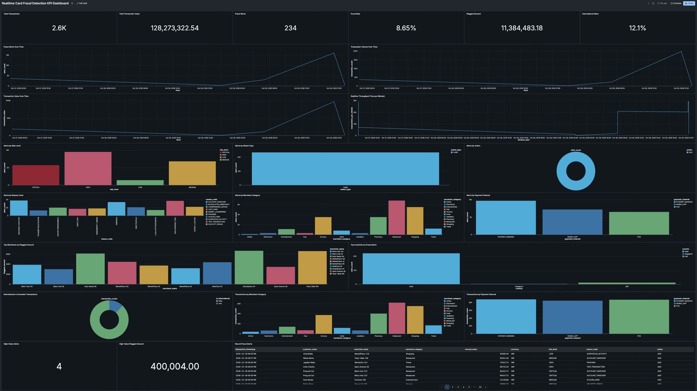
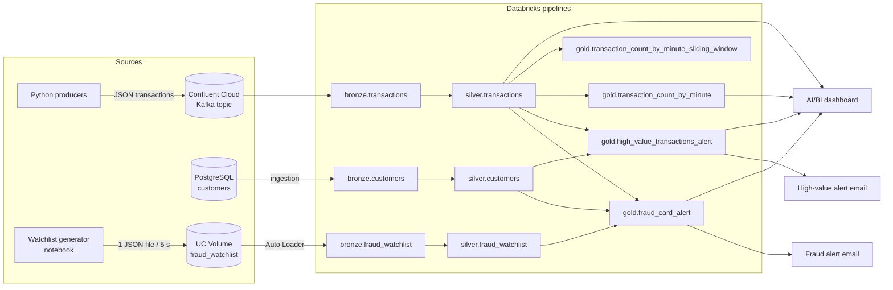
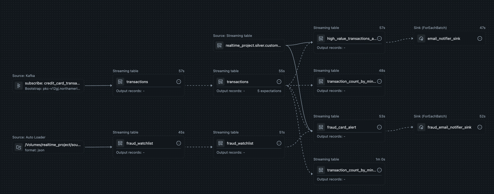
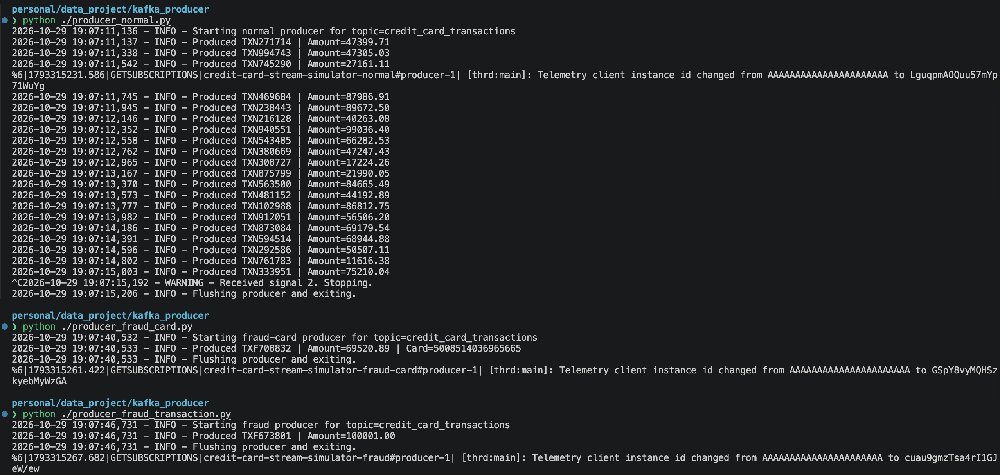
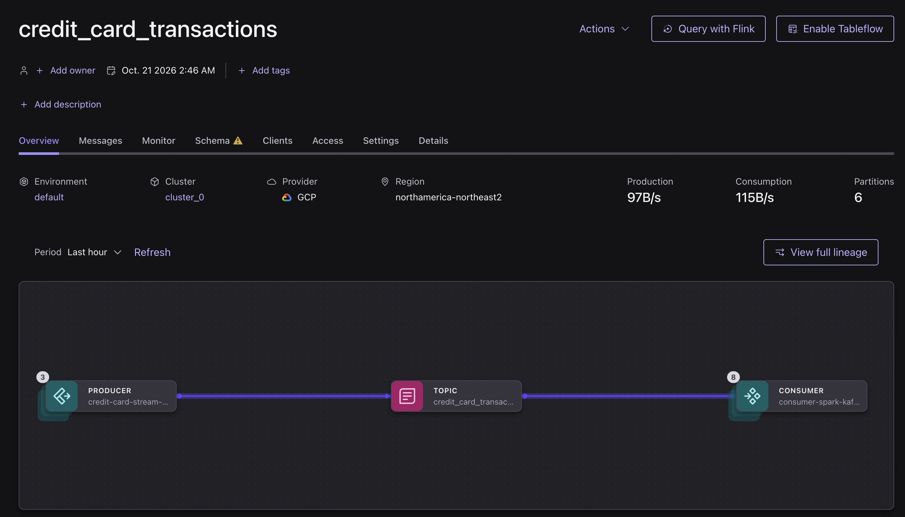
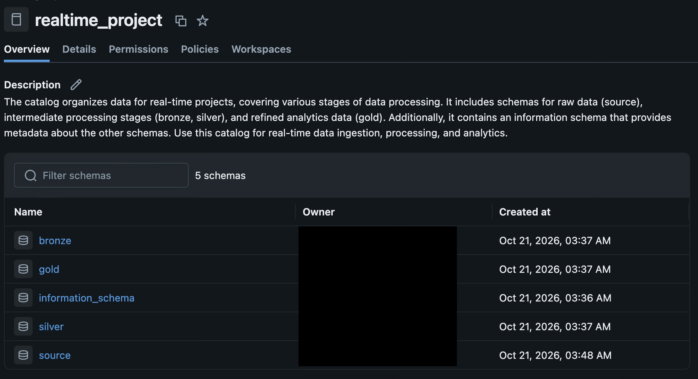
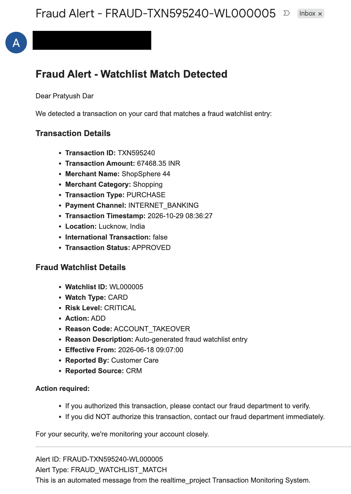
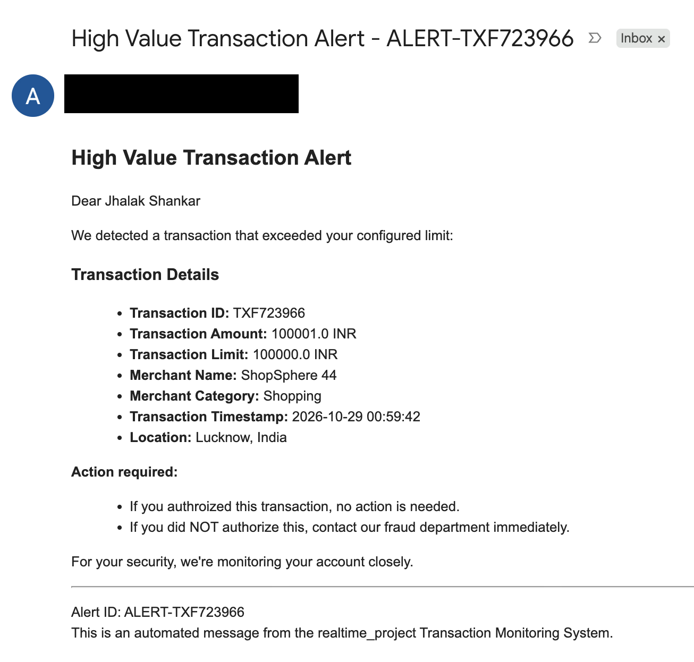

# Realtime Card Fraud Detection

An end-to-end streaming data project. Python simulates credit card transactions and sends them to Kafka. Databricks reads the stream, cleans it through bronze, silver and gold Delta tables, flags suspicious transactions, emails the customer, and shows live KPIs on a dashboard.

<!-- SCREENSHOT: Full dashboard view. Save as docs/screenshots/dashboard_overview.png -->


---

## What it does

1. **Generate.** Python producers send fake card transactions to a Kafka topic on Confluent Cloud.
2. **Enrich.** Customer details (name, email, spending limit) live in PostgreSQL. A fraud watchlist of compromised cards arrives as JSON files.
3. **Process.** Databricks pipelines stream all three sources through bronze → silver → gold tables.
4. **Detect.** Two rules flag a transaction:
   - the card number is on the fraud watchlist, or
   - the amount is above the customer's transaction limit.
5. **Alert.** Each flagged transaction sends an HTML email to the customer.
6. **Monitor.** A Databricks dashboard shows volume, value, fraud rate and alert breakdowns.

---

## Architecture



<!-- SCREENSHOT: Streaming pipeline graph in Databricks. Save as docs/screenshots/pipeline_graph.png -->


---

## Tech stack

| Part | Tool |
| --- | --- |
| Data generation | Python 3.10+, Faker, pandas, numpy |
| Event stream | Confluent Cloud Kafka (`confluent-kafka`, SASL_SSL) |
| Customer master data | PostgreSQL |
| Processing | Databricks Lakeflow Declarative Pipelines (`pyspark.pipelines`), Structured Streaming, Auto Loader |
| Storage | Delta tables in Unity Catalog |
| Alerts | Gmail SMTP |
| Dashboard | Databricks AI/BI dashboard |

---

## Repo layout

```
.
├── kafka_producer/                     # Local Python app: sends fake transactions to Kafka
│
├── postgresql/
│   ├── customers_historic.sql          # Creates and loads the customers table (1,000 rows)
│   └── customers_incremental.sql       # Adds 2 customers and updates 1 (simulates changes)
│
├── data_pipeline/                      # Databricks code
│   ├── fraud_watchlist/
│   │   ├── fraud_watchlist.csv                    # 341 watchlist entries
│   │   └── fraud_watchlist_data_generator.py.py   # Notebook: drips CSV rows into a Volume as JSON
│   ├── realtime_project_customers_silver_load/    # Pipeline 1: customers bronze -> silver
│   └── realtime_project_streaming/                # Pipeline 2: main streaming pipeline
│       ├── bronze/    
│       ├── silver/    
│       ├── gold/      
│       └── alerts/   
│
└── dashboard/
    └── Realtime Card Fraud Detection KPI Dashboard
```

---

## How it works

### 1. Data sources

**Transactions (Kafka).** The producers pick a random customer and a merchant that fits the customer's segment (for example, Platinum customers shop at hotels, airlines and jewellers). Each message is JSON, keyed by `transaction_id`:

```json
{
  "transaction_id": "TXN482913",
  "customer_id": "CUST000001",
  "card_number": "4321819600133898",
  "merchant_id": "MER0002",
  "merchant_name": "Tasty Table 2",
  "merchant_category": "Restaurant",
  "amount": 18450.75,
  "currency": "INR",
  "transaction_type": "PURCHASE",
  "payment_channel": "POS",
  "device_id": "DEV0001",
  "city": "Hyderabad",
  "country": "India",
  "transaction_timestamp": "2026-10-29T10:15:42Z",
  "is_international": false,
  "status": "APPROVED"
}
```

| Producer | What it sends | Triggers |
| --- | --- | --- |
| `producer_normal.py` | A continuous stream, `TRANSACTIONS_PER_SECOND` per second. Amount between 1 and 99,999.99. | Fraud watchlist alert when the random customer's card is on the watchlist (283 of 1,000 cards are). |
| `producer_fraud_card.py` | One transaction on card `5008514036965665` (watchlist entry `wl000001`). | Fraud watchlist alert, every time. |
| `producer_fraud_transaction.py` | One transaction with amount ≥ 100,001. | High-value alert, every time (default limit is 100,000). |

`fraud_engine.py` scores each transaction locally (high value, impossible travel, new device, velocity, card testing and more). The producers remove `fraud_score` and `fraud_reason` before sending, so Databricks does its own detection from raw data.

<!-- SCREENSHOT: Producer terminal output. Save as docs/screenshots/producer_terminal.png -->


<!-- SCREENSHOT: Messages arriving in the Confluent Cloud topic. Save as docs/screenshots/kafka_topic.png -->


**Customers (PostgreSQL).** `customers_historic.sql` loads 1,000 customers. Each row has an `email` (where alerts go) and a `transaction_limit` (default 100,000). Customer IDs and card numbers match the ones the producers generate. `customers_incremental.sql` adds two customers and updates one, to show that changes flow through.

**Fraud watchlist (JSON files).** `fraud_watchlist.csv` holds 341 entries for compromised cards, with risk level, reason code (for example `PHISHING`) and reporter. The generator notebook writes one row every 5 seconds as a JSON file into `/Volumes/realtime_project/source/fraud_watchlist/source_data/`. This simulates a live feed. If you stop and restart it, it resumes after the last `watchlist_id` it wrote.

### 2. Pipeline layers

All tables live in the `realtime_project` catalog.

| Layer | Table | What it holds |
| --- | --- | --- |
| Bronze | `bronze.transactions` | Raw Kafka messages: key, value (as string), topic, partition, offset, timestamp. |
| Bronze | `bronze.fraud_watchlist` | Raw watchlist JSON loaded by Auto Loader, plus the source file path. |
| Bronze | `bronze.customers` | Raw copy of the PostgreSQL table. Ingestion is set up in Databricks, not in this repo. |
| Silver | `silver.transactions` | JSON parsed into columns. Drops rows with a null `transaction_id`, `customer_id`, `card_number` or `merchant_id`. Logs a warning when `amount <= 0`. |
| Silver | `silver.fraud_watchlist` | IDs, risk level and action in upper case. `effective_from` parsed to a timestamp. |
| Silver | `silver.customers` | Clean customer records, including `email` and `transaction_limit`. |
| Gold | `gold.fraud_card_alert` | Transactions whose card is on the watchlist, joined with the customer's name and email. |
| Gold | `gold.high_value_transactions_alert` | Transactions where the amount is above the customer's limit. |
| Gold | `gold.transaction_count_by_minute` | Transaction count per 1-minute window. |
| Gold | `gold.transaction_count_by_minute_sliding_window` | Transaction count per 5-minute window, sliding every minute. |

<!-- SCREENSHOT: Catalog Explorer showing the bronze, silver and gold schemas. Save as docs/screenshots/unity_catalog_tables.png -->


### 3. Detection rules

| Alert | Rule | Gold table | Email subject |
| --- | --- | --- | --- |
| Fraud watchlist match | `transactions.card_number = fraud_watchlist.entity_id` | `gold.fraud_card_alert` | `Fraud Alert - FRAUD-<txn_id>-<watchlist_id>` |
| High-value transaction | `transactions.amount > customers.transaction_limit` | `gold.high_value_transactions_alert` | `High Value Transaction Alert - ALERT-<txn_id>` |

The watchlist join is a stream-to-stream join with a 5-minute watermark on both sides. The customer lookup is a stream-to-static join.

### 4. Email alerts

The `alerts/` files read each gold alert table as a stream. For every new row, they build an HTML email with the transaction details (and watchlist details for fraud alerts) and send it to the customer's email through Gmail SMTP. The Gmail app password comes from the secret scope.

<table>
  <tr>
    <td><!-- SCREENSHOT: Fraud alert email. Save as docs/screenshots/fraud_alert_email.png -->
      </td>
    <td><!-- SCREENSHOT: High-value alert email. Save as docs/screenshots/high_value_alert_email.png -->
      </td>
  </tr>
  <tr>
    <td align="center">Fraud watchlist alert</td>
    <td align="center">High-value transaction alert</td>
  </tr>
</table>

### 5. Dashboard

The dashboard reads `silver.transactions` and the gold tables. It has 24 widgets:

| Section | Widgets |
| --- | --- |
| Headline KPIs | Total Transactions, Total Transaction Value, Fraud Rate, Fraud Alerts, Flagged Amount, International Share, High-Value Alerts, High-Value Flagged Amount |
| Trends | Fraud Alerts Over Time, Transaction Volume Over Time, Transaction Value Over Time, Realtime Throughput (transactions per minute) |
| Alert breakdowns | By Risk Level, Watch Type, Action, Reason Code, Merchant Category, Payment Channel |
| Rankings | Top 10 Merchants by Flagged Amount, Top 10 Countries by Fraud Alerts |
| Transaction mix | International vs Domestic, By Merchant Category, By Payment Channel |
| Detail | Recent Fraud Alerts table |
